# 架构

这份文档按仓库里的实现来画，不是设计意图或路线图。每张图下面都写了它对应哪些文件，
方便对着代码读。看不清、或者代码和 README 对不上的地方，标成 **待核实**，没有猜。

一句话概括：一个 Node 单进程既是 HTTP/WebSocket 服务，也是 agent 编排器。
它把每个 Bot 的一个 PI 会话握在手里，PI 负责循环、工具集和上下文压缩，
我们负责 **工具跑在哪**（沙箱）、**哪些要人点头**（审批门）、**人看到什么**（步骤日志）。

## 图目录

| # | 标题 | 看的是什么 |
| --- | --- | --- |
| 1 | [系统总览](#图-1系统总览) | 三种客户端到本地 Server 到模型提供商，旁路沙箱、MCP、例行任务、审批 |
| 2 | [源码模块与依赖](#图-2源码模块与依赖) | `src/` 各目录之间谁依赖谁 |
| 3 | [一次对话回合](#图-3一次对话回合) | 用户消息 → 协议 → runner → 工具调用 / 审批卡 / 回复 |
| 4 | [审批门的判定](#图-4审批门的判定) | 一次 `tool_call` 从拦截到放行或驳回 |
| 5 | [Run 的状态](#图-5run-的状态) | `RunStatus` 之间怎么走 |
| 6 | [模型提供商：配置与取用](#图-6模型提供商配置与取用) | sqlite 存 key → 环境变量 → `models.json` 的 `$GB_KEY_…` |
| 7 | [选哪个模型](#图-7选哪个模型) | per-bot 模型、账号默认、`.env` 种子导入的优先级 |
| 8 | [沙箱目标与网络隔离](#图-8沙箱目标与网络隔离) | docker 驱动、内部网络、出网代理 |
| 9 | [出网白名单的判定](#图-9出网白名单的判定) | 三种 egress 模式，以及 MCP 不在这条路上 |
| 10 | [MCP 工具的接入](#图-10mcp-工具的接入) | stdio 子进程 → 工具表 → PI 工具定义 |
| 11 | [数据与持久化](#图-11数据与持久化) | sqlite 里的实体关系 |
| 12 | [状态存在三个地方](#图-12状态存在三个地方) | sqlite、PI 的 jsonl 转录、进程环境变量 |
| 13 | [Bot 之间：转交与群聊](#图-13bot-之间转交与群聊) | `message_bot` 的异步转交，和群里的发言轮次 |
| 14 | [例行任务](#图-14例行任务) | 从 `schedule_routine` 到被调度器唤醒 |
| 15 | [桌面应用的进程结构](#图-15桌面应用的进程结构) | Electron 主进程怎么拉起并盯着 orchestrator |
| 16 | [介绍站与主应用的关系](#图-16介绍站与主应用的关系) | `website/` 为什么不参与 `pnpm build` |

---

## 图 1：系统总览

三种客户端加载的是同一个页面；Server 是一个进程；沙箱、MCP 服务器和模型提供商都在进程之外。

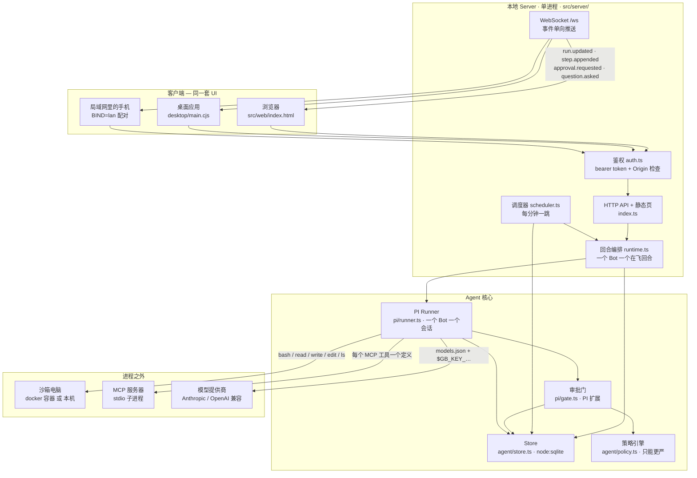

**对应文件**：`src/server/index.ts`（路由与启动顺序）、`src/server/auth.ts`、`src/server/runtime.ts`、
`src/server/scheduler.ts`、`src/pi/runner.ts`、`src/pi/gate.ts`、`src/agent/store.ts`、`src/agent/policy.ts`。

几个容易看错的地方：

- **沙箱是按「所有者」缓存的，不是按 Bot**。`src/sandbox/index.ts` 的缓存键是
  `` `${target}::${ownerId}` ``，`src/sandbox/types.ts` 的注释也写明了：同一个所有者的
  所有 Bot 共用一台沙箱电脑，所以 Bot 之间**没有**互相隔离。
- 当前是单所有者。`src/server/index.ts` 里 `OWNER = process.env.OWNER_ID ?? 'local'`，
  注释称之为 "Stage 0 is single-user"，身份是占位符而不是认证。
- 页面本身不鉴权（`GET /`），token 是服务端注入进 HTML 的；`/api/*` 才要 bearer token。

---

## 图 2：源码模块与依赖

箭头是 import 方向。`protocol.ts` 是共享类型，几乎所有人都依赖它，为了图不糊成一团，
这里只画它被 server 和 agent 引用的那条边。

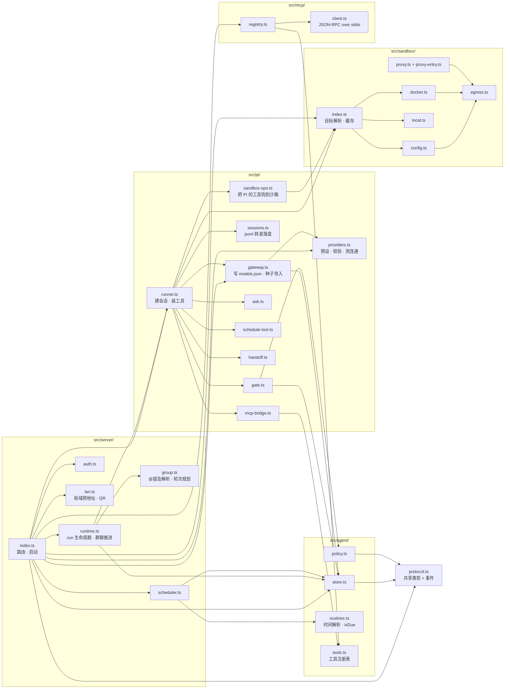

一条刻意留下的反向依赖：`runner.ts` 不 import `runtime.ts`。
「怎么开一个 run」是 runtime 的事，所以 runtime 启动时用 `setHandoffDeps()`
把 `deliver` / `isBusy` 注进 runner，避免两个模块互相依赖（`src/pi/runner.ts` 注释说明了这一点）。

---

## 图 3：一次对话回合

从 `POST /api/bots/:id/messages` 到屏幕上出现回复。注意 HTTP 立刻返回 202，
真正的过程全部走 WebSocket。

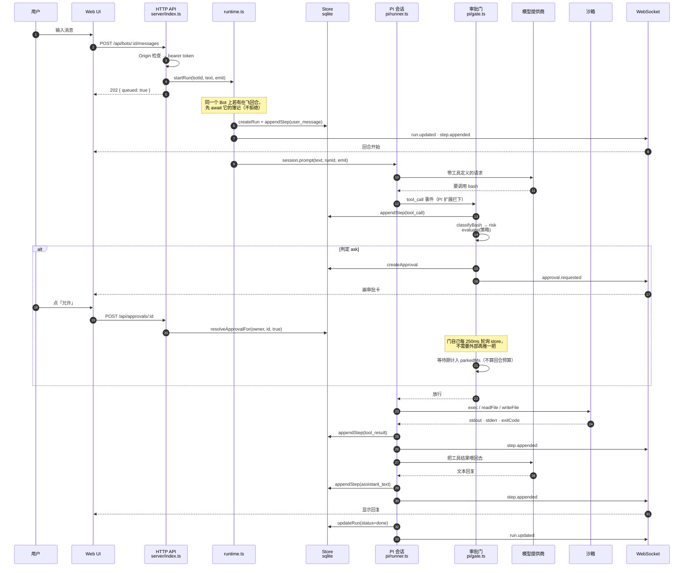

几个实现细节，图里塞不进但影响行为：

- **消息不会被拒**。Bot 正忙时新消息也接受，PI 用 `streamingBehavior: 'followUp'` 接住；
  这里只把簿记串行化，让每条消息有自己的 run、屏幕顺序和输入顺序一致。
- **审批没有超时**。门会一直等到有人回答或 run 被停掉（`src/pi/gate.ts`）。
  等人的时间通过 `onWaited` 回报，从回合预算里扣掉，所以「人决定得慢」不会被当成「卡住」。
- **回合预算**默认 `MAX_WALLCLOCK_MS=900000`（15 分钟），只算模型自己的时间。
  超了之后，因为 `Sandbox.exec` 只有超时没有 `AbortSignal`，跑着的命令打断不了，
  所以是**放弃这个会话**而不是等它：给 3 秒钟干净收尾，不行就把会话从 map 里摘掉，
  下一条消息开一个新的。
- **问题卡之后不再说话**。`ask_choice` 调用过之后，同一回合里模型再写的文本会被扣下，
  只记成 `note`（`withheld after a question card: …`），因为按钮本身就是那个问题。

---

## 图 4：审批门的判定

门是一个 PI 扩展，挂在 `tool_call` 上。两个性质比别的都重要：
**处理函数抛异常等于拦住这次调用**（所以这个文件里的 bug 不会把门悄悄打开），
以及**注册失败会在启动时抛错**（扩展形状写错时 PI 会静默忽略，那看起来和「根本没有门」一模一样）。

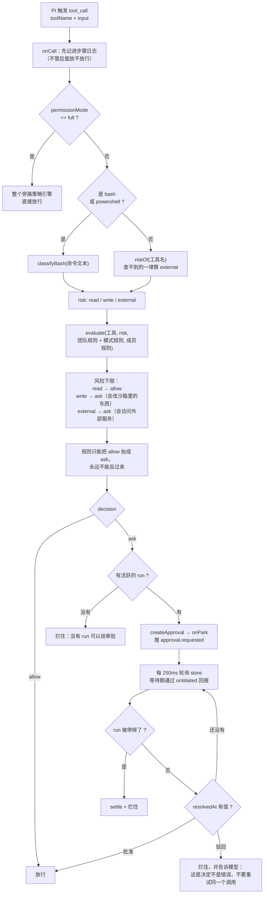

**为什么 `full` 是另一条代码路径**：规则引擎按设计只能变严
（`RANK: allow=0, ask=1`，只在更严时覆盖）。也就是说「完全权限」没法用一条规则表达出来，
提示注入写出来的「规则」永远到不了那里。它只能由人在设置里打开，
打开时服务端还会往日志里写一行，因为之后的步骤日志里看不出某次工具调用从来没被送去审批。

**`classifyBash` 的保守方向**（`src/agent/policy.ts`）：只有能完整说清的命令才算 `read`，
其余（包括解析不了的）一律算 `write`。具体地：

- 出现 `; & | > < \`` 、`$(`、`${` 或换行 → `write`（`ls; rm -rf /` 是以 `ls` 开头的）
- 命令名里带 `/`（绝对或相对路径的二进制）→ `write`
- `sudo` / `su` / `doas` → `write`
- `git` / `npm` / `pnpm` / `docker` 按子命令判（`git log` 是读，`git push` 是写）
- 白名单里的只读命令，但带了 `-exec` `-execdir` `-delete` `-ok` `-okdir` → `write`
- 网络命令**故意**不在只读名单里：往哪儿连是 egress 策略的事，而且一个离开沙箱的请求
  即使本地什么都没改，也值得一次决定

工具自身的风险等级（`src/pi/gate.ts` 的 `TOOL_RISK`）：

| 工具 | 风险 | 说明 |
| --- | --- | --- |
| `read` `ls` `grep` `find` | `read` | `grep` / `find` 实际没有暴露给模型，见下 |
| `bash` `powershell` `write` `edit` | `write` | bash 按命令文本再细分 |
| `ask_choice` `list_routines` `list_bots` | `read` | |
| `schedule_routine` | `write` | 等于让 Bot 承诺无人值守地行动 |
| `message_bot` | `external` | 会让另一个 Bot 花钱、碰真系统 |
| MCP 工具 | `read` 或 `external` | 只有列进 `readOnlyTools` 的算 `read` |
| 其它（查不到的） | `external` | |

`grep` 和 `find` **故意没有提供给模型**（`src/pi/runner.ts` 有一整段注释）：
这两个工具会在「跑这段代码的那台机器」上拉起子进程（ripgrep、find），
它们的 `*Operations` 钩子只提供上下文行，搜索本身绕过了沙箱这道缝。
在 docker 目标上它们会去搜 orchestrator 的文件系统。模型要搜索仍然可以，走 `bash`。

---

## 图 5：Run 的状态

`RunStatus` 在 `src/protocol.ts` 定义。`budget_exceeded` 在类型里存在，
但当前代码里超预算走的是 `failed` 加一条中文说明，所以用虚线标出。

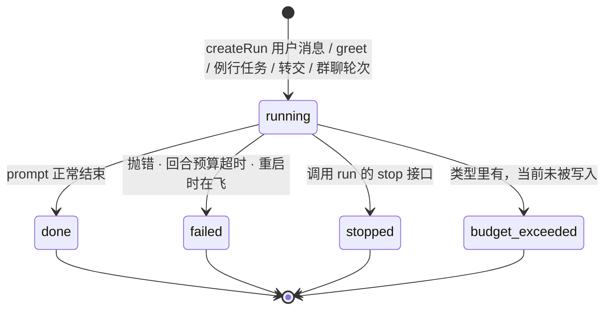

- `waiting_approval` 同样在类型里，但当前实现不把它写进 `runs.status`：
  审批是另一张表（`approvals`）加一个推送事件，run 在等人时仍然是 `running`。
- **停止 run** 会把挂着的审批全部置为驳回（让门的处理函数停止等待），然后丢掉 PI 会话。
  丢会话是硬停的代价，会话里的对话状态随之没了，下一条消息开新的。
- **重启** 时 `reconcileOnBoot()` 把所有 `running` 的 run 收成 `failed`，
  并追加一条 note：转录和上下文还在，再说一次就能接着做。
  不自动续跑，因为「续一个做了一半的工具序列」不是可以靠猜的事。

---

## 图 6：模型提供商：配置与取用

这一块的要点是 **key 不写进任何我们生成的文件**。
`models.json` 里只有 `$GB_KEY_…` 这样的引用，PI 在请求时才去环境变量里取值。

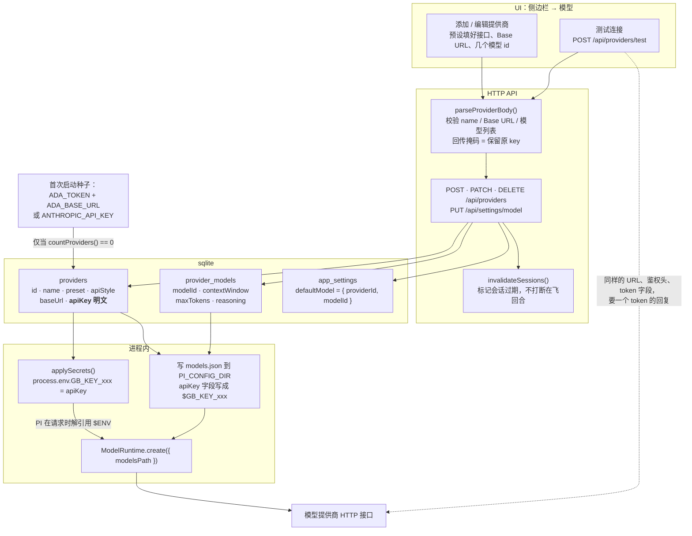

**对应文件**：`src/pi/providers.ts`（预设、校验、`models.json` 文档、测连通）、
`src/pi/gateway.ts`（种子导入、写文件、选择解析、日志脱敏）、
`src/agent/store.ts`（`providers` / `provider_models` / `app_settings` 三张表）。

细节：

- **环境变量名**由 provider 的 uuid 压扁而来：`GB_KEY_` + 去掉非字母数字后转大写
  （`envName()`）。对一个 provider 来说这个名字是稳定的，重写 `models.json` 还指向同一个变量。
- **空 key**（比如 Ollama）会被写成占位值 `local`，因为 PI 认为没有鉴权的模型不可用。
  那个占位符不是凭证。
- **key 回显**只给掩码：前 4 后 4（`sk-a…wxyz`），8 字符及以内整个折叠成 `••••••••`。
  客户端把掩码原样回传时，`parseProviderBody` 认作「别动这个 key」。
- **日志脱敏**：`redactSecrets()` 把 store 里每个长度 ≥ 8 的 key 在错误文本里替换成 `•••`，
  HTTP 500、启动日志、run 失败的 note 都过这一层。
- **内置预设**（`PRESETS`）：OpenAI、DeepSeek、Anthropic、Moonshot/Kimi、Qwen/DashScope、
  OpenRouter、Ollama、自定义 OpenAI 兼容。另有一个 `ada` 只作为种子导入用的 preset id，
  不在 UI 预设列表里。
- **兼容标记**（`compatFor()`）：只有 `openai-chat-completions` 才有。官方 OpenAI 不加覆盖，
  其余按最小公分母处理（system 角色、`max_tokens`、不开 strict 工具）。
  DeepSeek / OpenRouter / Qwen 各自多一个 `thinkingFormat`，DeepSeek 还要
  `requiresReasoningContentOnAssistantMessages`。
- **接口名有两套叫法**：UI 和存储用 `openai-chat-completions`，PI 用 `openai-completions`，
  `piApi()` 负责翻译。

---

## 图 7：选哪个模型

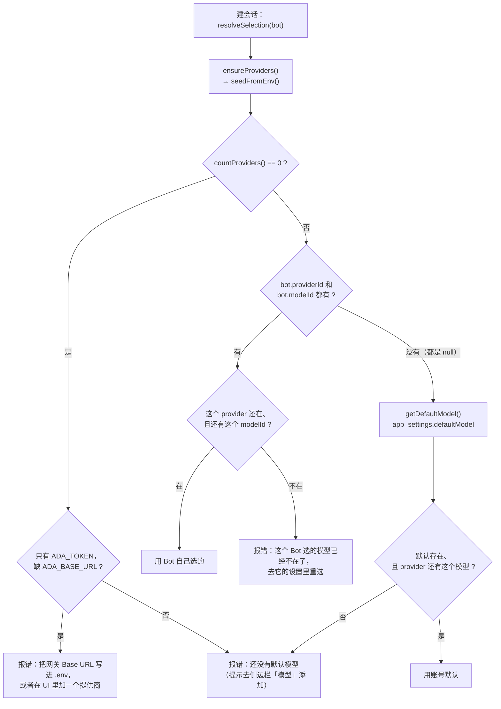

**种子导入只在数据库里一个 provider 都没有时发生**（`seedFromEnv` 第一行就是
`if (store.countProviders() > 0) return;`）。两个来源：

| 环境变量 | 导入成什么 | 是否成为默认 |
| --- | --- | --- |
| `ADA_TOKEN` + `ADA_BASE_URL`（+ 可选 `PI_MODEL`） | name `Gateway`，preset `ada`，接口 `anthropic-messages`，带三个已确认存在的网关模型 | 两者都在时它是默认 |
| `ANTHROPIC_API_KEY`（+ 可选 `MODEL_ID`） | name `Anthropic`，`https://api.anthropic.com` | 只有在上面那条缺席时才成为默认 |

之后 `.env` 不再被读。改模型在 UI 里做。

**一致性维护**（都在 `src/agent/store.ts` / `src/server/index.ts`）：

- 删 provider：指向它的 Bot 被置回 `NULL`（落到默认）；如果它是默认，
  下一个还有模型的 provider 接上，没有就清掉默认。
- 改 provider 的模型列表：`releaseBotsFromMissingModels()` 把指向已消失 modelId 的 Bot 置回默认；
  默认本身指向消失的模型时，改指该 provider 的第一个模型。
- 任何改动之后调 `invalidateSessions()`：**标记过期而不是直接丢**。
  在飞的回合用它开始时那个模型跑完，下一条消息才建新会话。

---

## 图 8：沙箱目标与网络隔离

一个「目标」就是「这个 Bot 的电脑在哪」。同一份代码既驱动本机 daemon 也驱动远程的：
docker CLI 接受 `-H ssh://host` 或一个命名 context，所以远程目标原样复用整条网络隔离路径。

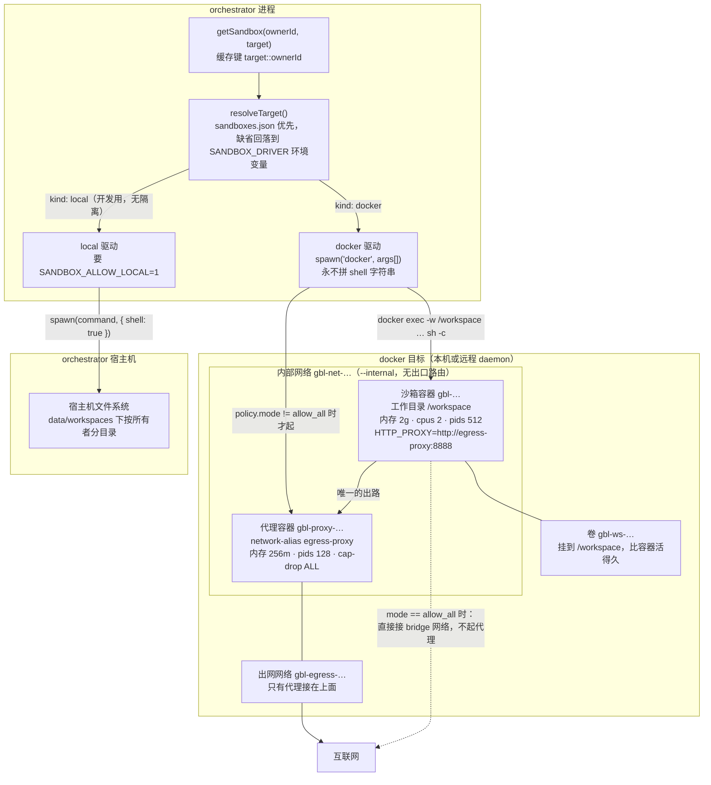

**对应文件**：`src/sandbox/index.ts`、`src/sandbox/config.ts`、`src/sandbox/docker.ts`、
`src/sandbox/local.ts`、`src/sandbox/proxy.ts`、`src/sandbox/proxy-entry.ts`、`src/pi/sandbox-ops.ts`。

要点：

- **`--internal` 网络是真正的控制，环境变量只是方便客户端**。沙箱容器只接在内部网络上，
  除了代理没有别的出路；那几个 `HTTP_PROXY` 环境变量是给 curl/npm 这类客户端看的便利，
  不是强制手段（`src/sandbox/docker.ts` 注释写了这一点）。
- **代理只看 CONNECT 的主机名**，不终止 TLS，看不到路径也看不到内容。
  这是刻意选的粒度：按主机白名单放行，而执行白名单的东西本身读不到被它管的流量。
- **代理的源码是 `docker cp` 进去的**，不是 bind mount —— bind mount 在 *daemon* 的文件系统上解析，
  远程目标那是另一台机器。copy 走 daemon API，本机和远程行为一致。
  容器里用 `node --experimental-strip-types` 直接跑 `.ts`，所以过滤逻辑只有一份。
- **命令怎么进容器**：`docker exec -w /workspace <容器> sh -c <命令>`，用 args 数组传，
  模型写的命令文本进不了宿主机的 shell。写文件的内容走 stdin，不进 argv 也不进 shell 字符串。
- **`local` 驱动没有任何隔离**，要 `SANDBOX_ALLOW_LOCAL=1` 才肯启动。它的 `resolve()`
  把文件工具限制在工作区内，但注释明确写了这不是安全边界：一条 shell 命令仍然能到这个进程能到的任何地方。
- **工作目录对模型说什么就是什么**：docker 驱动报 `/workspace`，local 驱动报它真正在的宿主机路径。
  告诉模型 `/workspace` 而 `cd /workspace` 又失败，会让它浪费回合怀疑自己的工具。
- **管理调用有 60 秒超时**（inspect / create / cp 等），agent 自己的命令**故意不限时**，
  只有模型显式要求超时才传。
- **切换目标** 是 per-bot 的配置改动，状态不跟着走：文件、登录态、装好的包都留在原来那台。
  API 在响应里把这件事直接说出来。

---

## 图 9：出网白名单的判定

三种模式在 `src/sandbox/egress.ts`。白名单按标签边界做后缀匹配：
`example.com` 能匹配 `api.example.com`，但永远匹配不到 `notexample.com`。

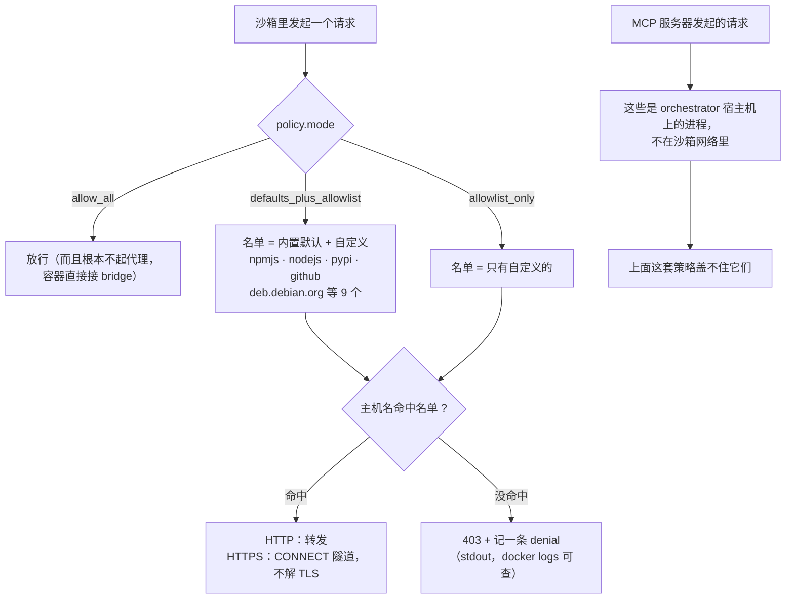

**这是文档里特意强调的坑，不是 bug**：挡住一个服务的网站，不等于挡住它的 MCP 服务器，反过来也一样。
服务启动时如果同时存在 MCP 服务器和受限目标，日志里会直接打一行说明。

> **待核实**：`applyToMcp` 这个开关在当前代码里**没有生效路径**。
> `mcpAllowed()` 定义在 `src/sandbox/egress.ts`，但除了 `scripts/egress-test.ts` 之外没有任何调用方；
> 而 `src/mcp/registry.ts` 和 `src/mcp/client.ts` 只支持 **stdio 子进程**形态的 MCP 服务器
> （`spawn(command, args)`），没有远程 URL 的接入路径。
> 也就是说：README 和 `sandboxes.example.json` 里写的「`applyToMcp` 为真时远程 MCP 受同一份名单约束」
> 目前是一个**已实现但未接线**的能力 —— 判定函数在、测试在，缺的是远程 MCP 这一侧。
> stdio MCP 不受约束这一点，描述与代码一致。

---

## 图 10：MCP 工具的接入

MCP 服务器在端口打开**之前**加载完，所以不会有 run 跑在半满的工具表上。

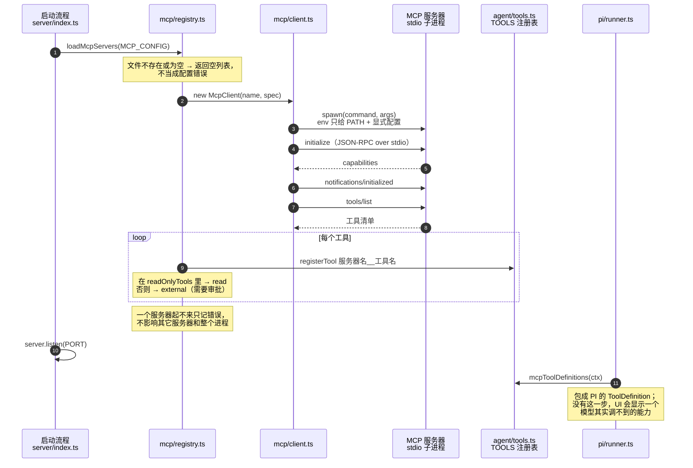

- 工具名会被清洗成 `[a-zA-Z0-9_-]`，拼成 `服务器名__工具名`，因为这个名字要递给模型。
- 子进程的环境**只给 `PATH` 加显式配置的 `env`**，不继承整个 `process.env`，
  这样一个行为不端的服务器读不到我们环境里不相关的凭证。
- MCP 工具是从 **orchestrator 进程**里调用的，不是从沙箱里 —— 这正是图 9 那条注记的原因。
- 单次 RPC 超时 30 秒；stderr 只打日志，从不解析。

---

## 图 11：数据与持久化

一个 sqlite 文件（`DB_PATH`，默认 `./data/app.db`），`node:sqlite` 直接开，
`journal_mode = WAL`，`foreign_keys = ON`。下面是**在用的**表。

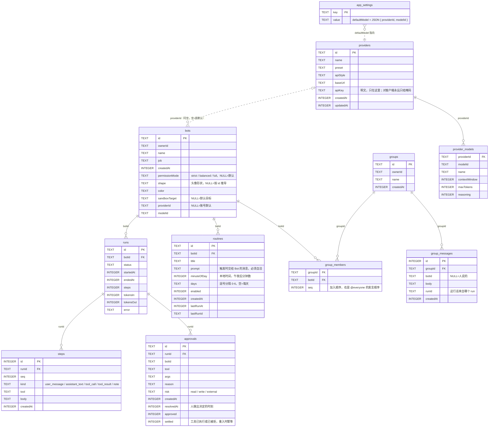

**已经不写入的四张表**：`messages`、`tool_executions`、`memories`、`digests`。
PI 接管循环之后，转录、工具执行、记忆和上下文压缩都归 PI，所以没有东西再写它们。
表留着是因为老数据库里有真实的行，而且迁移测试会用到 —— 按历史读，不要当成活状态
（`src/agent/store.ts` 里有一段大写注释写明了这件事）。

**迁移**：`CREATE TABLE IF NOT EXISTS` 对已存在的表什么都不做，所以后来加的列
必须同时列进 `MIGRATIONS` 数组，由 `migrate()` 用 `ALTER TABLE … ADD COLUMN` 补上。
目前有 7 条：`bots.sandboxTarget`、`approvals.settled`、`bots.permissionMode`、
`bots.shape`、`bots.color`、`bots.providerId`、`bots.modelId`。
测试总是从空文件开始，这正是这类 bug 会先在真实数据库上出现的原因。

**按所有者收口的读**：`getRunFor` / `listStepsFor` / `getApprovalFor` / `resolveApprovalFor`
这些带 `ownerId` 的方法是给「由请求驱动」的调用方用的 —— 一个 id 本身不是授权。
不带所有者的版本留给已经确定在操作哪个 Bot 的调用方（runner、门）。
别人的行读起来是「不存在」而不是「禁止」，这样探测也学不到那个 id 存在。

---

## 图 12：状态存在三个地方

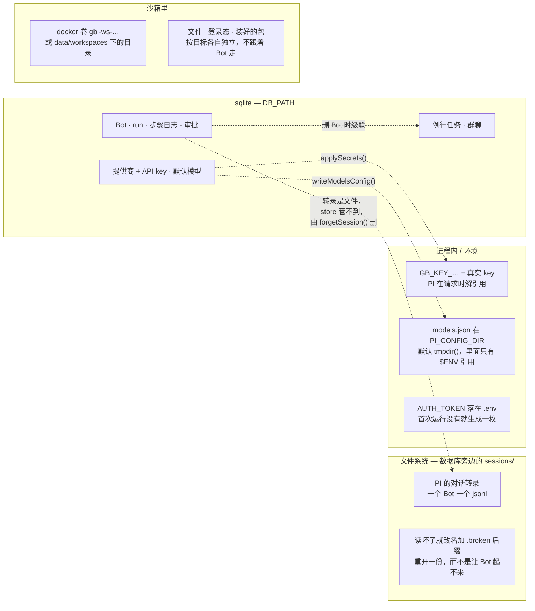

**删一个 Bot** 时发生的事（`DELETE /api/bots/:id`）：先拒绝正在工作的 Bot，
然后 `dropSession()` 停掉 PI 会话、外键级联删掉 runs / steps / approvals / routines / 群成员关系、
再 `forgetSession()` 删掉磁盘上的转录。API 的响应里明确说：
沙箱里的文件和登录状态是共用的，没有动。

---

## 图 13：Bot 之间：转交与群聊

两条机制，刻意不混用：**一对一转交**走 `message_bot`，**多方讨论**走群聊的 `@`。
一个 Bot 在群里同时用两者，等于往同一个会话塞两个 prompt，PI 会用
"Agent is already processing" 拒掉第二个、链条无声中断 —— 所以群聊回合里 `message_bot` 被禁用。

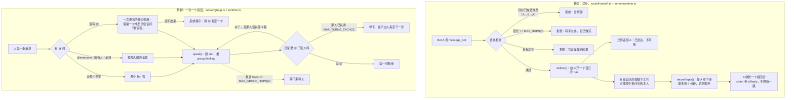

- **转交为什么是异步的**：早先是内联等回复，结果「接收方停在审批上」会把发起方挂死，
  而转交最有用的场景恰恰就是对方要花点时间的那种（`src/server/runtime.ts` 注释）。
- **接收方用自己的权限**。一个 `balanced` 模式的 Bot 不管是谁让它写文件，都会先问它的主人。
  委派不是借别人的权限。
- **一个 Bot 一个在飞回合**。忙的时候转交被拒绝而不是排队，这样扇出不会悄悄变成积压。
- **群聊人数**限制在 2–6 个（`GROUP_MIN` / `GROUP_MAX`）。再多的话，一条不带 @ 的消息
  有太多个「看起来该答」的人，记录会变成噪音。
- **轮次上限是按 Bot 算的，不是「谁说过」**。把任何重复发言都当成绕圈会破坏正常情况：
  两人组里「A 问 B，B 答 A，A 把活干完」本来就是全部意义所在。

---

## 图 14：例行任务

调度刻意做得粗：**一个时间点加哪几天**，不是 cron。
一个 run 要等模型、有时还要等审批，假装精确到分钟是这套系统兑现不了的承诺。

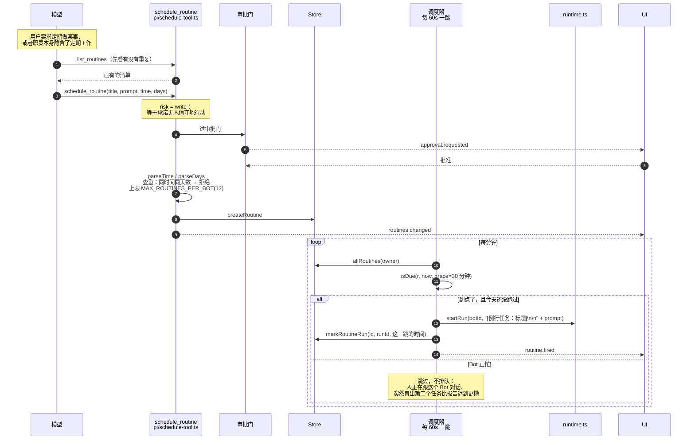

两件它**故意不做**的事：

- **不补课**。`isDue` 只在预定时间之后的 30 分钟窗口内触发，所以中午打开笔记本
  不会让四个早上的任务一起跑起来。
- **不排队**。撞上活跃工作的例行任务直接跳过，明天再试。

`markRoutineRun` 记的是**这一跳对应的时间**而不是墙上时钟，
否则「触发了什么」和「记下了什么」之间会有缝 —— 生产上看不见，
但时钟被校正或遇到夏令时切换时会让任务跑两次。

---

## 图 15：桌面应用的进程结构

窗口是个瘦客户端，加载的就是浏览器那同一个页面。主进程加的是浏览器标签页做不到的三件事：
挑一个没人用的端口把 orchestrator 拉起来并盯着它、
把审批请求推到没在看应用的人面前、关了窗口还继续干活。

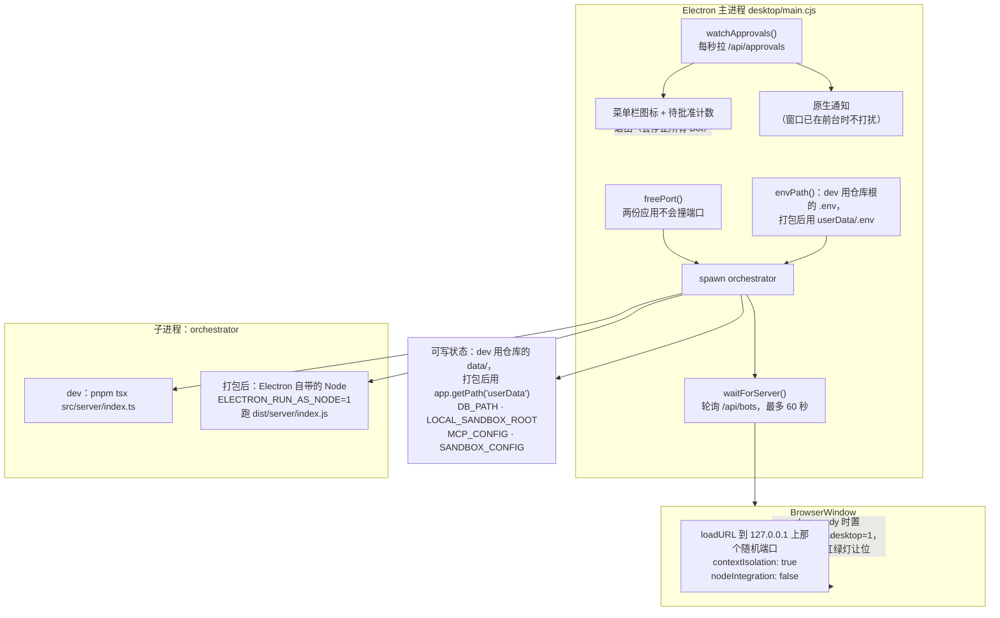

- **关窗口不退出**。`win.on('close')` 阻止默认行为改成隐藏，
  `window-all-closed` 里什么都不做 —— 让活继续跑就是这个应用存在的理由。
- **通知用轮询而不是 WebSocket**：否则主进程要为渲染进程已经有的那条通道
  重新实现一遍鉴权和重连。一个本来就会无限等待的提示，晚一秒没有代价。
- **token 从文件读**。服务端只在「铸造它的那一次」把 token 打到日志里，
  所以已经存在时要从 `.env` 里取，否则审批通知会静默失效。
- **打包后不另带一个 Node 运行时**，用 Electron 自己的；
  也因此 `dist/` 是编译产物而不是 `.ts`（Electron 的内置 Node 版本不做类型剥离）。

> **待核实**：`desktop/main.cjs` 第 102 行仍然硬性要求 `ADA_TOKEN`，
> 没有就弹框「缺少模型凭证」然后 `app.quit()`。
> 但模型提供商早已改成在应用里配置（提交 `1914274`「在应用里配置模型提供商，不再写死在 .env」），
> `.env` 只是数据库为空时的一次性种子。`git log` 显示 `desktop/main.cjs`
> 最后一次改动是更早的 `f3a9822`，那次提交没有同步这里。
> 按代码读：**桌面应用目前仍然起不来，除非 `.env` 里有 `ADA_TOKEN`**，
> 即使用户打算在 UI 里配 DeepSeek。这看起来是漏改而不是设计，但没有在这次工作里动代码。

---

## 图 16：介绍站与主应用的关系

`website/` 是静态产品介绍页，和主应用**没有构建期关系**。

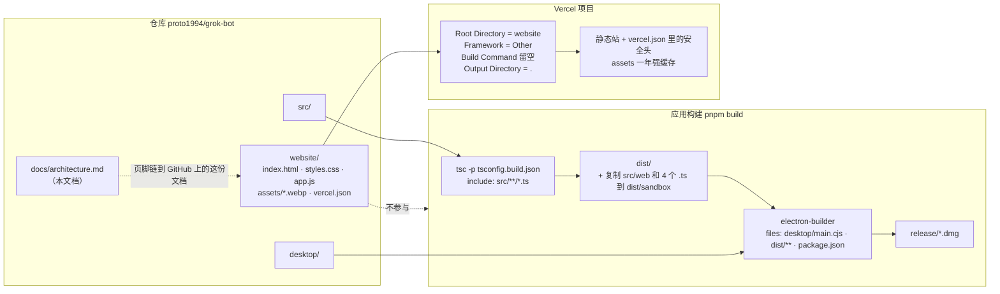

为什么说「不参与」有依据：

- `tsconfig.build.json` 的 `include` 只有 `src/**/*.ts`；
- `scripts/build.mjs` 只复制 `src/web/{index.html,shapes.js}` 和 `src/sandbox` 的 4 个 `.ts`；
- `electron-builder.yml` 的 `files` 只列了 `desktop/main.cjs`、`dist/**/*`、`package.json`；
- `pnpm test` 的链路里没有任何一步进 `website/`。

介绍站自己也没有构建步骤：纯静态文件，中英双语靠 `html[data-lang]` 配合
`.t-zh` / `.t-en` 两份文案做 CSS 切换，深浅色靠 `data-theme`，
语言和主题记在 `localStorage`。截图是浏览器测试拍下的 12 张 PNG 转 WebP。

---

## 附：几处值得单独记一笔的实现决定

| 决定 | 在哪 | 为什么 |
| --- | --- | --- |
| 审批是规则引擎，不是提示词里的一句话 | `agent/policy.ts` | 模型可以被说服绕过一条指令，但说服不了一个函数 |
| 规则只能更严 | `policy.ts` 的 `RANK` | 提示注入写出来的「规则」永远到不了完全权限 |
| 门注册失败就拒绝服务 | `gate.ts` 的 `assertRegistered()` | 扩展形状写错时 PI 静默忽略，那和「没有门」长得一样 |
| `thinkingLevel: 'low'` 而不是 `off` | `pi/runner.ts` | 思考关掉后模型把推理写进回复，答案上面多一行英文 |
| 种子模型声明 `reasoning: true` | `pi/gateway.ts` 的 `ADA_MODELS` | PI 只在模型声明支持时才向提供方请求思考；为 false 时 thinkingLevel 被接受然后忽略 |
| `grep` / `find` 不暴露给模型 | `pi/runner.ts` | 它们的搜索会在宿主机上跑，绕过沙箱这道缝 |
| 页面 token 由服务端注入 HTML | `server/index.ts` | 别的源的页面读不到这份 HTML，所以学不到 token |
| 先查 Origin 再查 token | `server/auth.ts` | 泄露的 token 不应该能从任意网站上用 |
| WebSocket 的 token 走 query | `server/auth.ts` | 浏览器没法给 WebSocket 设请求头 |
| 手机的 Origin 要和它请求的 Host 对得上 | `auth.ts` 的 `originAllowed` | Host 由浏览器自己设，别的源伪造不了 |
| QR 编码器手写在仓库里 | `server/lan.ts` | 只为一个用途，不值得加一个依赖 |

## 还没有核实的地方

1. **`applyToMcp` 没有生效路径** —— 判定函数和测试都在，但生产代码无人调用，
   且 MCP 只支持 stdio 形态，没有远程 MCP 这一侧。见图 9 下方。
2. **桌面应用仍硬性要求 `ADA_TOKEN`** —— 与「在应用里配置提供商」这一改动不一致。见图 15 下方。
3. `protocol.ts` 里的 `RunStatus` 有 `waiting_approval` 和 `budget_exceeded` 两个取值，
   当前代码不往 `runs.status` 写它们。是留给以后，还是遗留，从代码本身看不出来。

